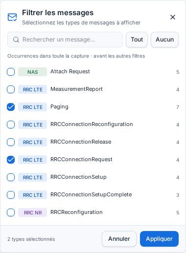
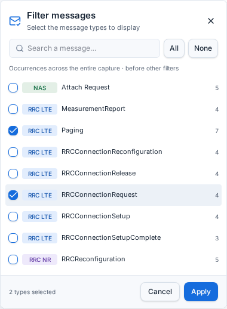
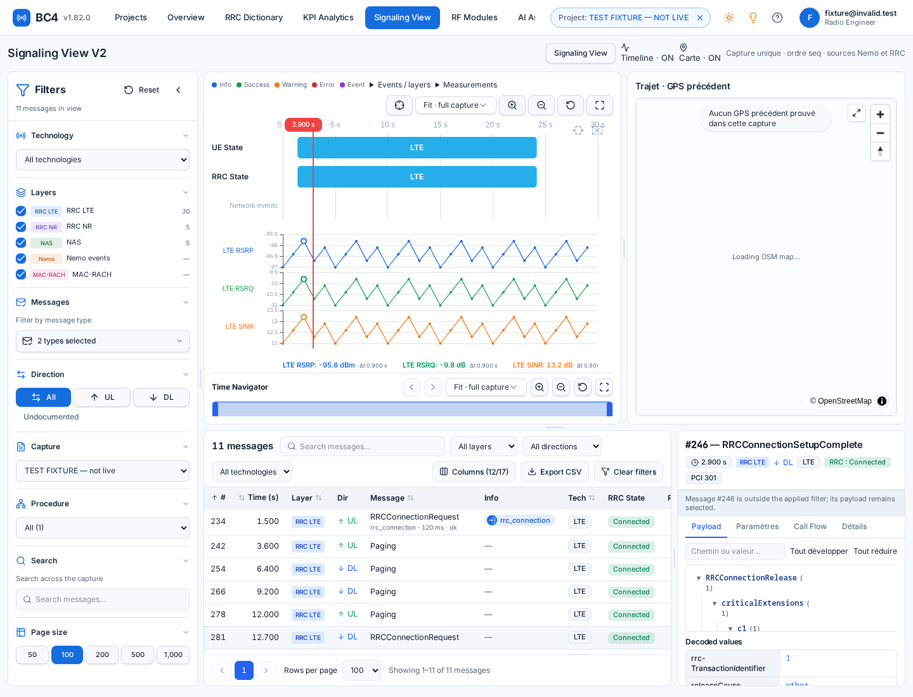
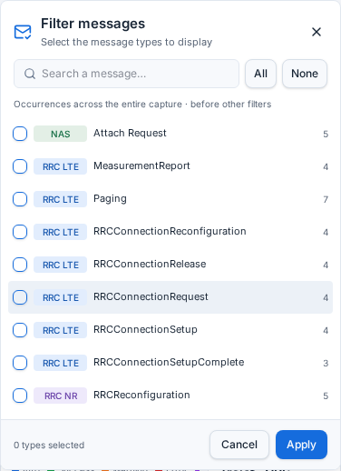

# BC4 message filters — 1.82.0

## Implemented
Compact sidebar in the requested section order, collapsible sections and sidebar, resizable filter column, portal-based message popup. Local case-insensitive search, name/layer badges, whole-capture counts, temporary selection, All/None on search-visible types, Cancel/Apply, explicit empty selection, compatible capture reconciliation. Filtering, pagination and CSV use the same complete selected population. The selected payload is preserved and explicitly labelled when outside the applied filter. No timeline, RF, navigator, GPS, parser or backend changes; no publication.

## Evidence and limits
- PASS: 106 Signaling tests across 13 test files; includes 11 new selection, population integrity and popup transaction tests.
- PASS: targeted ESLint for new modules/tests, no diagnostics.
- PASS: latest harness typecheck/build entry reports build OK.
- PASS (browser simulation, NOT live VM): actual Signaling page, zero page errors; popup opens beside sidebar with unchanged bounds; selection restricts 40 fixture rows to 11; Cancel preserves applied rows; empty selection leaves zero rows and retains payload; checkbox/search actions issue no requests; UL combines with type filtering; CSV contains the same selected rows; French popup displays translated labels; capture change reconciles; 400 px popup remains inside viewport at x=12, width=376.
- NOT RUN: real authenticated VM capture readback. One login attempt with stored reader credentials returned 401. No credentials changed or disclosed.
- NOT RUN: large real-capture latency, hundreds of types, real multi-page UI performance and final user visual approval. The adapter is tested with multiple pages and rejects missing/duplicate/changing populations.
- API limitation: no validated exact-type aggregate/filter endpoint is present. The frontend uses the existing paginated rows endpoint, bounded to three concurrent page requests and cached per capture. The first popup opening may load multiple pages before showing counts. No partial counts are presented as capture totals.

## Changed files
- src/features/signaling/SignalingPage.tsx
- src/features/signaling/SignalingFilters.tsx
- src/features/signaling/MessageFilterPopover.tsx
- src/features/signaling/message-filter.ts
- src/features/signaling/signaling.css
- src/lib/api/signaling-message-types.ts
- src/lib/api/client.ts
- src/styles.css
- src/locales/en.json and fr.json
- src/test/signaling-message-filter.test.ts
- src/test/signaling-message-popover.test.tsx
- package.json, CHANGELOG.md, AGENTS.md, roadmap.md

## Browser screenshots
The screenshots below contain clearly identified fixture data, never authenticated VM evidence.

